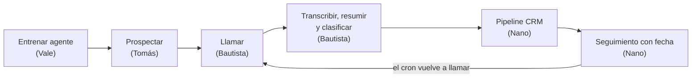

# Tratunex — Brief del MVP (v2)

Plataforma para que **cualquier empresa** prospecte clientes en frío con un agente de voz que llama por teléfono, detecta si del otro lado hay un cliente potencial y deja todo registrado en un CRM con seguimiento automático.

Este documento es la **fuente de verdad** del proyecto: alcance, reparto, contratos, datos y reglas. Si algo de código, de Linear o de otro documento lo contradice, gana este brief; para cambiarlo, abrí un PR que lo modifique.

- Tareas: proyecto **Tratunex MVP** en Linear, equipo `TRA`.
- Versión colaborativa con comentarios: [Brief Tratunex v2](https://claude.ai/artifact/2m4dgom69C8jqhcxYVZTMw) (pedile acceso a Bautista). Si difiere de este archivo, gana este archivo.
- Cómo trabajar con ramas, commits y PR: [`DEVELOPMENT_WORKFLOW.md`](DEVELOPMENT_WORKFLOW.md).

---

## 1. Qué construimos

Tres ideas guían todo:

- **Configurable, no programado.** Cada empresa entrena a su agente desde un dashboard: contexto, conocimiento, instrucciones y criterios. El mismo motor sirve para una distribuidora, una agencia o un estudio contable.
- **Cada llamada deja un registro útil.** Transcripción, resumen, clasificación (¿es cliente potencial?) y próxima acción, visibles para quien administra.
- **Confiable.** Si un aviso llega dos veces, alguien hace doble clic o un proceso se repite, nada se duplica (idempotencia).

## 2. Qué cambió respecto del brief original

El brief original (Sur Insumos, pedidos, cobros en USDC y compras a proveedores) se reemplazó por este. Sigue disponible en el historial de git.

| Antes | Ahora |
|---|---|
| Hecho a medida para una distribuidora | Multi-empresa: cualquier rubro configura su agente |
| Pedidos, cobros en USDC y compras a proveedores | **Fuera del MVP** |
| Campañas de hasta 20 contactos | **Fuera del MVP**; se llama contacto por contacto y por seguimiento |
| Dos agentes fijos (venta y compra) | Un agente base que cada empresa personaliza desde el dashboard |
| Vale: negocio y prospección · Tomi: comercio e infra | Vale: dashboard del agente · Tomás: plataforma y prospección |

## 3. Alcance del MVP

| Pieza | Qué hace |
|---|---|
| Multi-empresa | Cada empresa tiene su cuenta, usuarios y datos aislados (RLS). |
| Dashboard del agente | Contexto de la empresa, base de conocimiento, rubro, guion, instrucciones y criterios de calificación; prueba en vivo desde el navegador. |
| Prospección | Buscar empresas en la web (Firecrawl) o importar un CSV; guardar la fuente y no duplicar. |
| Agente de voz | Llama por teléfono (Vapi + Twilio), conversa, transcribe, resume y clasifica. |
| CRM y pipeline | Contactos, 7 etapas, historial de llamadas, tareas y seguimiento automático (volver a llamar). |

**Fuera del MVP:** pagos y cobros, compras a proveedores, campañas masivas, facturación del SaaS, integraciones con CRMs externos (HubSpot, Salesforce), WhatsApp y email.

**Demo:** dos empresas de rubros distintos (por ejemplo, una distribuidora de insumos y una agencia de marketing) usando el mismo sistema.

## 4. Flujo completo



La empresa entrena al agente una vez. Cada prospecto recorre el mismo ciclo y vuelve a ser llamado solo si quedó una tarea con fecha. El agente decide en la llamada si hay un cliente potencial; el CRM aplica las reglas del pipeline; el cron dispara los seguimientos sin nadie mirando.

## 5. Equipo, ownership y tareas

Cada persona hace frontend y backend de su parte. Leer código ajeno está permitido; **editarlo requiere acuerdo con su dueño**.

| Persona | Rol | Pantallas | Linear |
|---|---|---|---|
| Tomás | Plataforma y prospección | login, selector de empresa, `/prospects` | PLAT-01 a 09 (TRA-24 a TRA-32) |
| Vale | Dashboard del agente | `/agent`, `/agent/test` | AGT-01 a 09 (TRA-33 a TRA-41) |
| Bautista | Voz y número | `/calls`, `/calls/[id]` | VOZ-01 a 11 (TRA-42 a TRA-52) |
| Nano | CRM y pipeline | `/pipeline`, `/contacts/[id]`, `/tasks`, navegación | CRM-01 a 09 (TRA-53 a TRA-61) |

### Archivos de cada dueño

| Dueño | Carpetas y archivos | API | Tablas |
|---|---|---|---|
| Tomás | `package.json`, lockfile, configuración raíz, `.env.example`, `src/lib/**` (auth, env, http, clientes Supabase), `src/contracts/common.ts`, `src/features/platform/**`, `src/features/discovery/**`, `src/contracts/discovery.ts`, `src/app/login/**`, `src/app/prospects/**`, `supabase/migrations/**` (coordina), despliegue | `/api/prospects/**`, `/api/jobs/tick` | `companies`, `company_members`, `prospect_searches`, `prospect_candidates` |
| Vale | `src/features/agent/**`, `src/contracts/agent.ts`, `src/app/agent/**` | `/api/agent/**` | `agent_profiles`, `knowledge (columna de agent_profiles)`, `industry_templates` |
| Bautista | `src/features/voice/**`, `src/contracts/voice.ts`, `src/app/calls/**` | `/api/voice/**` | `calls`, `voice_events` |
| Nano | `src/features/crm/**`, `src/contracts/crm.ts`, `src/app/pipeline/**`, `src/app/contacts/**`, `src/app/tasks/**`, `src/app/layout.tsx`, `src/app/page.tsx`, `src/app/globals.css`, `src/components/ui/**` | `/api/crm/**` | `contacts`, `deals`, `tasks`, `call_results`, `activity_log` |

Reglas:

- Cada módulo expone sus funciones de servidor en `src/features/<módulo>/server/public.ts` (marcado `server-only`). Nada de un `index.ts` común que todos editen.
- Dirección de imports: `agent` y `crm` dependen solo de lo común; `discovery` usa `crm`; `voice` usa `agent` y `crm`. La UI del CRM inicia llamadas por HTTP (`POST /api/voice/calls`) para no crear un ciclo.
- Dentro del servidor, un módulo llama a otro por su función pública, no por HTTP. HTTP queda para el navegador, Vapi y el cron.
- Tomás coordina y aplica las migraciones. Cada dueño propone las de sus tablas. Las migraciones aplicadas no se editan y nadie resetea la base compartida.
- Revisión cruzada de PR: **Vale ↔ Nano** y **Bautista ↔ Tomás**. Un cambio de contrato lo revisa también quien lo consume.

### Dependencias entre personas

| Quién espera | Qué | De quién |
|---|---|---|
| Tomás · PLAT-06 importar prospectos | `upsertContact` | Nano · CRM-03 |
| Vale · AGT-06 probar en el navegador | asistente base de Vapi | Bautista · VOZ-03 |
| Bautista · VOZ-03 asistente con overrides | `getAgentConfig` (mientras tanto, prompt de prueba) | Vale · AGT-05 |
| Bautista · VOZ-07 entregar resultado | `recordCallResult` | Nano · CRM-05 |
| Bautista · VOZ-09 seguimientos | `claimDueFollowups` y el cron | Nano · CRM-07 y Tomás · PLAT-07 |
| Todos | repo, auth, contratos comunes | Tomás · PLAT-01 a 03 |

Para no bloquearse: cada dueño publica primero sus contratos y un `public.ts` que responde datos mock **rotulados como mock**, y después los reemplaza por la implementación real sin cambiar la firma.

## 6. Stack

| Capa | Elección |
|---|---|
| Runtime | Node.js 24, TypeScript estricto |
| App, UI y API | Next.js App Router, Tailwind, componentes propios, `lucide-react` para íconos |
| Validación | Zod |
| Base, auth y aislamiento | Supabase Postgres + Auth + RLS por empresa, `@supabase/ssr` |
| Voz y telefonía | Vapi + número Twilio importado (salientes); `@vapi-ai/web` para probar en el navegador |
| Modelo, transcripción y voz | `gpt-4.1-mini` (temperatura 0,2), Deepgram `nova-3` en español, voz en español latino; todo administrado por Vapi |
| Resumen y clasificación | Análisis estructurado de fin de llamada de Vapi, con schema propio |
| Prospección | Firecrawl (búsqueda + extracción) e importación CSV |
| Automatización | Supabase Cron llama a `POST /api/jobs/tick` cada minuto |
| Despliegue | Un proyecto Vercel y un proyecto Supabase |
| Pruebas | Vitest (reglas) y Playwright (recorrido) |

Tomás instala las dependencias una sola vez y fija versiones; los demás usan `npm ci`. Una dependencia nueva se pide a Tomás.

## 7. Arquitectura

**Cómo se generaliza el agente.** No se crea un asistente de Vapi por empresa. Hay **un asistente base** y, en cada llamada, el servidor arma el prompt con `getAgentConfig` (perfil, conocimiento, instrucciones, criterios), los datos del contacto y la **fecha y hora actuales de Argentina**, y lo pasa como override. Cambiar algo en el dashboard cambia la próxima llamada sin redeploy. Cada llamada guarda qué versión de la configuración usó.

**Conocimiento.** Para el MVP, texto y FAQs cargados en el dashboard que entran en el prompt, con un límite de tamaño visible. Búsqueda semántica sobre documentos largos queda para después.

**Webhook único.** `POST /api/voice/webhooks/vapi`, autenticado con `Authorization: Bearer <VOICE_WEBHOOK_SECRET>` (Custom Credential de Vapi guardada en el asistente). La empresa y el contacto se resuelven desde la llamada guardada (`provider_call_id`), **nunca** desde lo que diga el modelo ni desde un `company_id` del JSON.

**Desarrollo local.** Vapi no puede llegar a `localhost`: usar un túnel (ngrok o cloudflared) o probar contra el deploy compartido.

**Modos visibles.** `DISCOVERY_MODE` y `VOICE_MODE` (`mock` | `live`) se leen en el servidor. La interfaz muestra si una llamada es mock, voz web o teléfono real. Un adapter live sin credenciales falla con error explícito; nunca pasa en silencio a datos ficticios.

## 8. Modelo de datos y pipeline

Todas las tablas llevan `company_id` y RLS por membresía real (no `user_metadata`). IDs internos UUID; IDs de proveedores en columnas aparte. Fechas en UTC (`timestamptz`), mostradas en `America/Argentina/Buenos_Aires`.

| Tabla | Dueño | Para qué |
|---|---|---|
| `companies`, `company_members` | Tomás | Empresas y usuarios con su rol (admin, vendedor). |
| `prospect_searches`, `prospect_candidates` | Tomás | Búsquedas y resultados con su fuente. |
| `agent_profiles` | Vale | Rubro, contexto, propuesta de valor, tono, guion, objeciones, criterios, horario de llamadas. Versionado. |
| `agent_profiles.knowledge` | Vale | Productos, servicios, precios orientativos y FAQs, guardados dentro de cada versión del agente. |
| `industry_templates` | Vale | Plantillas por rubro (distribuidora, agencia, servicios profesionales, SaaS). |
| `calls` | Bautista | Cada intento: estado, `provider_call_id` (único), `source_task_id` (único si existe), versión del agente, transcripción, grabación, resumen y clasificación. |
| `voice_events` | Bautista | Avisos de Vapi, únicos por ID del proveedor. |
| `contacts` | Nano | Persona o empresa contactada: teléfono E.164, web, fuente, `do_not_contact`. |
| `deals` | Nano | Oportunidad en el pipeline; un contacto puede tener varias. |
| `tasks` | Nano | Próximas acciones (`callback` o `human_review`) con fecha, intentos, lease y llamada resultante. |
| `call_results` | Nano | Resultado recibido de Voz, único por `event_id`. |
| `activity_log` | Nano | Historial de todo lo que pasó en un contacto. |

Estado técnico de una llamada: `queued`, `ringing`, `in_progress`, `completed`, `failed`, `unknown`. Estado de una tarea: `pending`, `running`, `completed`, `failed`, `cancelled`.

### Etapas del pipeline

| Código | Etapa | Significa |
|---|---|---|
| `new` | Nuevo | Importado, sin llamar. |
| `contacted` | Contactado | Hubo intento sin conversación útil (buzón, no atendió, fallo técnico). |
| `potential_client` | Cliente potencial | El agente detectó interés y cumple los criterios. |
| `follow_up` | En seguimiento | Pidió que lo llamen o hay próxima acción con fecha. |
| `won` | Compró | Cierre positivo, lo marca una persona. |
| `lost` | No compró | Dijo que no. |
| `disqualified` | No calificado | No es el perfil o pidió no ser contactado. |

### Clasificación de cada llamada

La produce el análisis de fin de llamada (Bautista) con los criterios de la empresa (Vale):

- `answered_by`: `human` | `voicemail` | `unknown`.
- `is_potential_client`: `yes` | `no` | `unknown`, con el motivo.
- `outcome`: `interested` | `not_interested` | `callback_requested` | `wants_to_buy` | `not_assessed`.
- `do_not_contact_requested`: `true` si pidió explícitamente que no lo llamen más.
- `score`: 0 a 100 según los criterios de la empresa; `summary` de 3 a 5 líneas.
- `next_action`: ninguna, `callback` (con fecha) o `human_review`.

### Reglas para mover el pipeline (las aplica Nano en `recordCallResult`)

Se evalúan de arriba hacia abajo y **se aplica la primera fila que coincide**.

| # | Resultado de la llamada | Etapa resultante | Tarea |
|---|---|---|---|
| 1 | `do_not_contact_requested = true` | `disqualified` y `do_not_contact = true` en el contacto | — |
| 2 | Falló, buzón o desconocido | `contacted` (solo si estaba en `new`) | — |
| 3 | Humano + `not_interested` | `lost` | — |
| 4 | Humano + `is_potential_client = no` | `disqualified` | — |
| 5 | Humano + `callback_requested` sin fecha clara | `follow_up` | `human_review` para fijar la fecha |
| 6 | Humano + `callback_requested` con fecha | `follow_up` | `callback` con la fecha pedida |
| 7 | Humano + `wants_to_buy` | `potential_client` | `human_review` para que una persona cierre |
| 8 | Humano + `interested` o `is_potential_client = yes` | `potential_client` | según `next_action` |

Un evento nunca saca un deal de `won`, `lost` o `disqualified`. Una llamada fallida nunca pasa a `lost`.

## 9. Idempotencia y consistencia

Regla de oro: repetir un aviso, un clic o un proceso nunca duplica llamadas, tareas ni movimientos del pipeline.

- **Avisos de Vapi:** se guardan en `voice_events` con clave única por ID del proveedor **antes** de responder. Si llega repetido, se responde OK y no se procesa de nuevo.
- **Mutaciones:** cada una lleva un `action_id` estable que se conserva en los reintentos. Se guarda junto con el cambio en la misma transacción (función de Postgres; dos llamadas REST seguidas no son una transacción). Mismo `action_id` → mismo resultado; mismo `action_id` con otros datos → `CONFLICT`.
- **Iniciar llamada:** el botón se bloquea mientras envía y el servidor usa `action_id`. Si Vapi no responde en 10 s, la llamada queda `unknown` y se consulta a Vapi antes de reintentar; **nunca** se vuelve a llamar a ciegas.
- **Seguimientos:** el cron reclama tareas vencidas con lease (lote 5, 90 s, `lease_id` nuevo en cada reclamo). Dos ejecuciones no toman la misma tarea; un worker con lease viejo recibe `CONFLICT`. Completar una tarea significa "llamada iniciada y aceptada por Vapi", no "venta hecha". Otro intento comercial crea otra tarea.
- **Callback doble:** si el agente ya agendó un callback durante la llamada, el resultado final llega con `next_action: null`. Nano igual deduplica por llamada de origen + tipo + fecha.
- **Límites:** una llamada a la vez por empresa, máximo 2 intentos por contacto, 3 minutos por llamada, solo dentro del horario permitido de la empresa.
- **Prospectos:** se deduplica por teléfono normalizado y dominio dentro de la empresa; un `do_not_contact` nunca se pisa al reimportar.

## 10. Contratos entre módulos

Los nombres se congelan en la primera hora; después solo se agregan campos. Todo se valida con Zod y se exporta desde `src/contracts/`.

```ts
// src/contracts/common.ts (Tomás)
type Ctx = { company_id: string; actor_type: 'user' | 'voice' | 'system'; actor_id: string };
type ActionCtx = Ctx & { action_id: string };
type Result<T> =
  | { ok: true; data: T }
  | { ok: false; error: { code: ErrorCode; message: string; retryable: boolean } };
type ErrorCode =
  | 'VALIDATION_ERROR' | 'NOT_FOUND' | 'FORBIDDEN' | 'CONFLICT'
  | 'PROVIDER_ERROR' | 'PROVIDER_UNAVAILABLE' | 'RATE_LIMITED';
// HTTP: 400, 404, 403, 409, 502, 503, 429
```

El servidor arma `Ctx` desde la sesión, el webhook verificado o el cron. El modelo nunca decide `company_id`, actor ni permisos.

```ts
// Agente (Vale)
getAgentConfig(ctx): Result<{ prompt: string; criteria: QualificationCriteria; version: number }>

// Prospección (Tomás)
searchProspects(ctx, { query, location, limit }): Result<{ search_id; candidates: ProspectCandidate[] }>
importProspects(actionCtx, { candidate_ids }): Result<{ imported; existing; failed; contact_ids }>

// Voz (Bautista)
startCall(actionCtx, { contact_id, deal_id?, objective?, source_task_id? }): Result<{ call: CallDTO }>
dispatchDueCalls(ctx, { limit }): Result<{ processed; pending; failed }>   // lo llama el cron

// CRM (Nano)
upsertContact(actionCtx, input): Result<{ contact: ContactDTO; created: boolean }>
getContact(ctx, { contact_id }): Result<{ contact: ContactDTO }>
recordCallResult(actionCtx, CallResultV1): Result<{ event_id; duplicate: boolean; deal: DealDTO | null; tasks: TaskDTO[] }>
scheduleFollowup(actionCtx, { contact_id, deal_id?, source_call_id?, kind, due_at, reason }): Result<{ task: TaskDTO }>
claimDueFollowups(actionCtx, { limit, lease_seconds }): Result<{ tasks: TaskDTO[] }>
completeFollowup(actionCtx, { task_id, call_id, lease_id }): Result<{ task: TaskDTO }>
failFollowup(actionCtx, { task_id, lease_id, error_code, retry_at? }): Result<{ task: TaskDTO }>
```

Resultado que Voz le entrega al CRM:

```ts
type CallResultV1 = {
  schema_version: '1';
  event_id: string;           // estable: derivado del ID del evento de Vapi
  occurred_at: string;        // ISO UTC
  company_id: string;
  call_id: string;
  contact_id: string;
  deal_id: string | null;
  agent_version: number;
  technical_status: 'completed' | 'failed';
  answered_by: 'human' | 'voicemail' | 'unknown';
  is_potential_client: 'yes' | 'no' | 'unknown';
  outcome: 'interested' | 'not_interested' | 'callback_requested' | 'wants_to_buy' | 'not_assessed';
  do_not_contact_requested: boolean; // pidió explícitamente que no lo llamen más
  score: number | null;
  summary: string;
  transcript_url: string | null;
  next_action: null | { type: 'callback' | 'human_review'; due_at: string | null; reason: string };
};
```

`callback` exige `due_at` válido. Las listas HTTP devuelven `{ items, next_cursor }` con límite inicial 50.

## 11. Variables de entorno

Tomás publica `.env.example` con nombres y valores vacíos. Los valores se pasan por un canal privado; **nunca** se suben a git ni se ponen con prefijo `NEXT_PUBLIC_` si son secretos.

```dotenv
NEXT_PUBLIC_SUPABASE_URL=
NEXT_PUBLIC_SUPABASE_PUBLISHABLE_KEY=
SUPABASE_SECRET_KEY=
FIRECRAWL_API_KEY=
VAPI_PRIVATE_KEY=
NEXT_PUBLIC_VAPI_PUBLIC_KEY=
VAPI_PHONE_NUMBER_ID=
VAPI_ASSISTANT_ID=
VAPI_WEBHOOK_CREDENTIAL_ID=
VOICE_WEBHOOK_SECRET=
JOBS_SECRET=
NEXT_PUBLIC_APP_URL=
DISCOVERY_MODE=mock
VOICE_MODE=mock
```

## 12. Cronograma

A las 11:00 el recorrido completo tiene que andar con datos mock; el resto del día es hacerlo real y robusto.

| Bloque | Tomás · Plataforma | Vale · Agente | Bautista · Voz | Nano · CRM |
|---|---|---|---|---|
| Antes del día | Cuentas Supabase, Vercel, Firecrawl | Plantillas de rubro en borrador | Vapi + Twilio y llamada de prueba a Argentina | Bocetos del pipeline |
| 09:00–09:45 | Repo, auth, contratos comunes | Esquema de perfil y conocimiento | Contratos de voz, llamada mock | Navegación, contratos CRM |
| 09:45–11:00 | RLS, multi-empresa, seed | Formularios del dashboard | `startCall` + webhook | Contactos y pipeline |
| 11:00–13:00 | Firecrawl e importación | Constructor de prompt y prueba web | Llamada real + análisis | `recordCallResult` e historial |
| 13:00–15:00 | Cron y dedupe | Plantillas y métricas por versión | Seguimientos automáticos | Tareas con lease |
| 15:00–16:30 | Pruebas de aislamiento | Pulido de UX | Duplicados, timeouts, buzón | Duplicados y eventos viejos |
| 16:30–18:00 | Deploy final | Ensayo de demo | Ensayo de llamadas | Ensayo del relato |

## 13. Criterio de terminado

- [ ] Dos empresas de rubros distintos usan la app sin ver los datos de la otra.
- [ ] Desde el dashboard se configura un agente y se prueba en el navegador.
- [ ] Se buscan e importan prospectos sin duplicar.
- [ ] Una llamada telefónica real termina con transcripción, resumen y clasificación en el contacto correcto.
- [ ] El pipeline se actualiza solo y distingue humano, buzón y fallo técnico.
- [ ] Un "llamame el jueves" crea una tarea y el cron hace la llamada sin navegador abierto.
- [ ] Un aviso repetido o un doble clic no duplica nada.
- [ ] Webhook, cron y API rechazan autenticación incorrecta y accesos de otra empresa.

## 14. Demo y riesgos

Recorrido de la demo (menos de 2 minutos):

1. Empresa 1: elegir plantilla de rubro y ajustar el agente en el dashboard.
2. Buscar prospectos e importar uno.
3. Llamada real a un teléfono del equipo (o grabación de una llamada real, rotulada como grabación).
4. Ver en el CRM el resumen, la clasificación y cómo el contacto pasó a Cliente potencial o En seguimiento.
5. Cambiar a la Empresa 2, de otro rubro: mismo sistema, otro agente.

| Riesgo | Plan B |
|---|---|
| Twilio no deja llamar a Argentina (cuenta trial o permisos geográficos) | Resolverlo antes del día (VOZ-01); si falla, voz web rotulada "sin llamada telefónica". |
| Costos de Vapi y Twilio | Definir antes quién pone la tarjeta y un tope de gasto. |
| Vapi no llega a `localhost` | Túnel (ngrok o cloudflared) o el deploy compartido. |
| El agente inventa precios o datos | Instrucción de usar solo el conocimiento cargado; probarlo con preguntas trampa. |
| Clasificación poco confiable | Schema estricto, criterios de la empresa en el prompt y `human_review` cuando no está claro. |
| Legal: grabar y llamar en frío | El agente se presenta como asistente virtual, avisa que la llamada se graba y respeta `do_not_contact`. |

## 15. Cómo trabajar

1. Tomá un issue tuyo de Linear (proyecto Tratunex MVP) y pasalo a **In Progress**.
2. `git fetch origin` y creá la rama desde `origin/main`: `git switch -c feat/TRA-123-descripcion origin/main`.
3. Commits chicos con prefijo (`feat:`, `fix:`, `docs:`, `chore:`, `test:`, `refactor:`).
4. PR con la plantilla, el issue enlazado y la evidencia de verificación. Pedí revisión a tu par: **Vale ↔ Nano**, **Bautista ↔ Tomás**.
5. Squash merge; el issue pasa a **Done**.

Detalle completo en [`DEVELOPMENT_WORKFLOW.md`](DEVELOPMENT_WORKFLOW.md).

### Prompt para tu asistente de programación

```text
Soy <nombre>, responsable de <rol> en Tratunex. Leé AGENTS.md y docs/BRIEF.md.
Trabajemos un issue de Linear por vez (<TRA-xx>). Solo modificá mis archivos
según la sección 5 del brief; si necesito algo de otro dueño, avisame qué pedir.
Respetá Ctx, ActionCtx, Result<T>, company_id y CallResultV1 tal como están.
Consumí otros módulos solo por su server/public.ts. Cada mutación lleva
action_id y es idempotente; nada de llamadas o reintentos a ciegas.
Mientras falten integraciones, usá mocks rotulados sin cambiar los contratos.
No subas secretos. Verificá cada issue con una prueba que demuestre su
comportamiento y decime qué comandos corriste y qué dieron.
```
